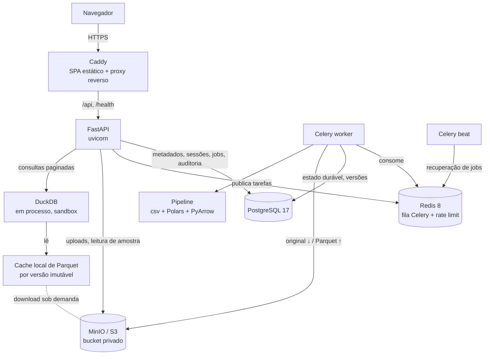
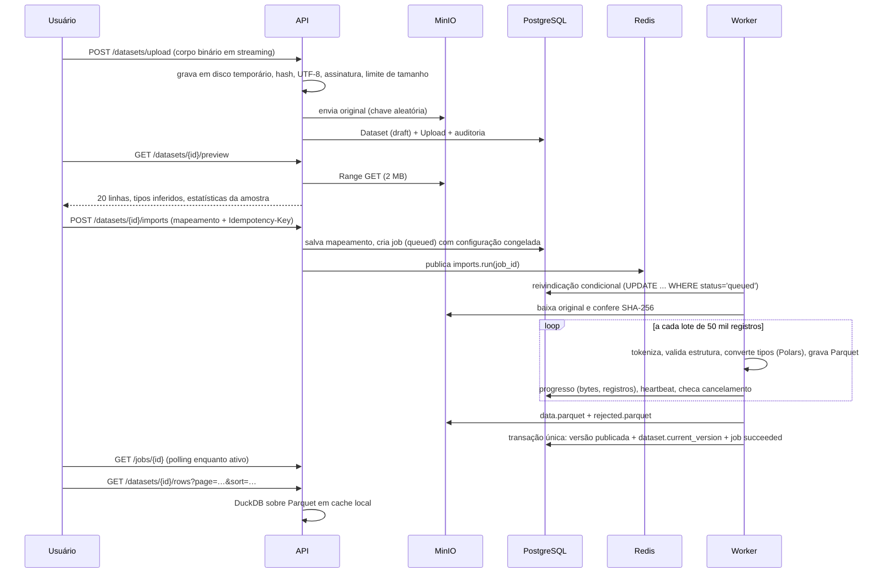

# Arquitetura

## Visão geral



| Componente | Responsabilidade |
| --- | --- |
| **apps/web** | SPA React + TypeScript. Consome apenas endpoints reais. Nunca mantém o dataset inteiro em memória: só a página atual. |
| **Caddy** | Serve o build estático, aplica CSP e cabeçalhos de segurança, limita corpo de requisição e faz proxy de `/api` e `/health`. HTTPS automático em produção. |
| **FastAPI** | Autenticação, RBAC, validação, upload em streaming, pré-visualização, criação de jobs e consultas. Não executa processamento pesado. |
| **Celery worker** | Executa o pipeline de importação. Compartilha modelos, regras e serviços com a API (mesma imagem e mesmo pacote `app`). |
| **Celery beat** | A cada 60 s recupera jobs interrompidos e reenfileira jobs cuja publicação na fila se perdeu. |
| **PostgreSQL** | Fonte da verdade: usuários, workspaces, sessões, datasets, colunas, uploads, jobs (estado durável) e versões. |
| **Redis** | Transporte da fila (sem backend de resultados) e contadores de rate limiting. |
| **MinIO (S3)** | Arquivos originais e Parquet das versões. Bucket privado; não há URL pública. |
| **DuckDB** | Consultas analíticas controladas sobre Parquet: ordenação, paginação (e, nas próximas fases, filtros e agregações). |

## Estrutura do repositório

```
apps/web/            SPA (React, Vite, Tailwind, shadcn/ui)
  src/app            providers, router (code splitting por rota), QueryClient
  src/components     componentes compartilhados + ui/ (shadcn)
  src/features       auth, datasets, jobs: API, hooks, componentes de domínio
  src/layouts        layout autenticado (sidebar/topbar) e de autenticação
  src/pages          telas
  src/services       cliente HTTP (CSRF, erros padronizados) e upload com progresso
backend/
  app/api            rotas, dependências (sessão, workspace, RBAC), middlewares, erros
  app/core           configuração, banco, segurança, permissões, rate limit, logs
  app/models         ORM SQLAlchemy 2
  app/schemas        contratos Pydantic da API
  app/repositories   consultas sempre filtradas por workspace
  app/services       casos de uso (auth, upload, preview, importação, jobs, armazenamento)
  app/processing     pipeline puro (sem banco): inspeção, inferência, leitura, conversão
  app/analytics      DuckDB e cache de Parquet
  app/tasks          Celery (app, tarefas, publicação)
  migrations/        Alembic
  tests/             Pytest
e2e/                 Playwright
docker/              Dockerfiles e Caddyfile
scripts/             gerador de dados sintéticos
samples/             amostras de 1.000 linhas (as maiores são geradas)
docs/                documentação técnica
```

## Fluxo de uma importação



## Isolamento entre workspaces

- O workspace ativo fica na **sessão do servidor** (`user_sessions.active_workspace_id`), nunca em parâmetro do cliente.
- A cada requisição, `get_context` revalida o pertencimento (`workspace_members`) e lê o papel do banco. Remover um membro tem efeito imediato.
- Toda consulta por ID passa por `repositories/datasets.py`, que filtra por `workspace_id` e responde **404** tanto para recurso inexistente quanto alheio (não revela existência).
- Chaves de armazenamento incluem o workspace, mas o acesso a objetos só acontece pela API após a checagem acima.

## Compartilhamento entre API e worker

Ambos usam a mesma imagem (`docker/api/Dockerfile`) e o mesmo pacote `app`. As regras de conversão vivem em `app/processing` e não dependem de banco nem de rede; `services/job_runner.py` orquestra estado, armazenamento e publicação. Assim a pré-visualização (API) e o processamento (worker) aplicam exatamente as mesmas regras de leitura.
